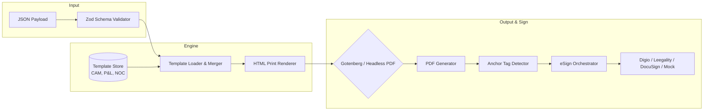

# 📄 FinGrid Dynamic Document Engine & eSign Pipeline

> High-throughput, template-driven document generation and multi-party eSign orchestration designed for modern fintech lending platforms.

---

## 💡 The Problem

In lending platforms like **FinGrid**, teams frequently end up writing bespoke code every time a new document or report is required (Credit Appraisal Memos, Balance Sheets, Profit & Loss extracts, No Objection Certificates, Sanction Letters).

This leads to:
* **Fragile codebase**: Business/legal layout tweaks require code refactors and deployments.
* **Inconsistent styling**: Misaligned pagination, broken page breaks, and unformatted financial figures.
* **Complex eSign flows**: Hardcoded coordinate calculations for signatures across different providers.

## 🚀 The Solution: FinGrid Dynamic Document Engine

FinGrid Document Engine completely decouples **Document Definition (Templates + JSON Schema)** from **Generation, Underwriting & eSign Delivery**:
1. **Zero-Code Template Addition**: Create a Handlebars/HTML template and drop it into `templates/`—the engine automatically discovers it and registers routes.
2. **Built-in Financial Helpers**: Native support for Indian Numbering System (`₹25,00,000.00`), Lakhs/Crores Number-to-Words (`Twenty-Five Lakh Rupees Only`), financial ratios (DSCR, Debt/Equity), and comparative YoY trends.
3. **Internalized Bureau Engine & Underwriting Scorecard**: Direct adapters for **TransUnion CIBIL** and **Experian** with legacy 36-month DPD string parsing, leverage aggregation, derogatory flag knockouts, and automatic CAM report hydration.
4. **In-House Bank Statement Analysis (BSA)**: Complete replacement for Glib.ai/Perfios with Indian banking narration regex classification, Average Monthly Balance (AMB) computation, inward/outward bounce detection, un-reported loan discovery, and automatic CAM Section 6 auto-hydration.
5. **Print-Perfect Rendering**: Native `@page` support, custom headers/footers, dynamic page numbering (`Page X of Y`), and watermarks.
6. **Pluggable eSign Gateway**: Unified interface supporting **Aadhaar eSign (Digio, Leegality)**, **DocuSign**, and a **Built-in Mock Provider** for zero-cost local testing.
7. **Smart Anchor Detection**: Scans for visual/text anchors (`[[sig:signer_role:width:height]]`) without requiring manual coordinate calculations.

---

## 🏛️ Architecture



---

## 📁 Project Structure

```
fingrid-doc-engine/
├── src/
│   ├── index.ts                 # Express Server & Health API
│   ├── cli.ts                   # Terminal CLI for fast local generation
│   ├── config.ts                # Environment configurations
│   ├── engine/
│   │   ├── template-loader.ts   # Auto-discovery & in-memory caching
│   │   ├── renderer.ts          # Handlebars data binding & metadata injection
│   │   ├── helpers.ts           # Financial helpers registration
│   │   └── pdf-generator.ts     # Gotenberg & headless PDF adapter
│   ├── esign/
│   │   ├── types.ts             # Signer & workflow schemas
│   │   ├── anchor-parser.ts     # [[sig:...]] token detector
│   │   ├── orchestrator.ts      # Multi-provider lifecycle state machine
│   │   └── providers/
│   │       ├── base.ts          # Common abstract provider
│   │       ├── mock.ts          # Zero-config simulation provider
│   │       ├── digio.ts         # Digio Aadhaar eSign & DSC
│   │       ├── leegality.ts     # Leegality e-Stamping & eSign
│   │       └── docusign.ts      # DocuSign REST API
│   ├── schemas/                 # Zod validation schemas
│   │   ├── cam-report.schema.ts
│   │   ├── profit-and-loss.schema.ts
│   │   ├── loan-closure.schema.ts
│   │   └── sanction-letter.schema.ts
│   └── routes/                  # REST API endpoints
│       ├── document.routes.ts
│       ├── esign.routes.ts
│       └── template.routes.ts
├── templates/                   # Reusable document templates
│   ├── partials/                # styles.hbs, header.hbs, footer.hbs, watermark.hbs
│   ├── cam-report/              # Credit Appraisal Memo template & sample data
│   ├── profit-and-loss/         # Comparative P&L template & sample data
│   ├── loan-closure/            # Loan Closure & NOC Certificate
│   └── sanction-letter/         # Key Fact Statement & Sanction Letter
├── tests/                       # Unit & integration test suite
├── Dockerfile                   # Production container definition
├── docker-compose.yml           # Preconfigured with Gotenberg Chromium
└── package.json
```

---

## ⚡ Quickstart

### 1. Install Dependencies
```bash
npm install
```

### 2. Run Tests
```bash
npm test
```

### 3. Generate Documents via CLI
Generate any document instantly without starting a server:

```bash
# List all discovered templates
npx tsx src/cli.ts list

# Generate CAM Report HTML from sample data
npx tsx src/cli.ts generate --template cam-report --out cam-output.html

# Generate Loan Closure NOC
npx tsx src/cli.ts generate --template loan-closure --out loan-closure.html

# Generate with custom data payload
npx tsx src/cli.ts generate --template profit-and-loss --data my-data.json --out pl.html
```

### 4. Start the REST API Microservice
```bash
npm run dev
```
Server starts at `http://localhost:4000/api/v1`.

---

## 📡 REST API Reference

### 1. List Available Templates
```http
GET /api/v1/templates
```

### 2. Render Document HTML
```http
POST /api/v1/documents/render
Content-Type: application/json

{
  "templateId": "cam-report",
  "data": { ... },
  "options": {
    "isDraft": false,
    "watermark": ""
  }
}
```

### 3. Generate PDF
```http
POST /api/v1/documents/generate-pdf
Content-Type: application/json

{
  "templateId": "loan-closure",
  "data": { ... }
}
```

### 4. Initiate eSign Workflow
```http
POST /api/v1/esign/initiate
Content-Type: application/json

{
  "templateId": "sanction-letter",
  "data": { ... },
  "signers": [ ... ]
}
```

### 5. Bureau Fetch & Underwriting Analytics
```http
POST /api/v1/bureau/analyze
Content-Type: application/json

{
  "name": "Acme Technologies Pvt Ltd",
  "pan": "AABCA8741E",
  "entityType": "COMMERCIAL",
  "provider": "CIBIL"
}
```

### 6. Auto-Hydrate CAM Bureau Section
```http
POST /api/v1/bureau/cam-bridge
Content-Type: application/json

{
  "name": "Apex Precision Engineering Pvt Ltd",
  "pan": "AABCA8741E"
}
```

### 7. Bank Statement Analysis (BSA - Glib.ai Replacement)
```http
POST /api/v1/bsa/analyze
Content-Type: application/json

{
  "bankName": "HDFC Bank Ltd",
  "accountNumberMasked": "XXXXXX9012"
}
```

### 8. Auto-Hydrate CAM Banking Section (Section 6)
```http
POST /api/v1/bsa/cam-bridge
Content-Type: application/json

{
  "bankName": "HDFC Bank Ltd",
  "accountNumberMasked": "XXXXXX9012"
}
```

---

## ✍️ How to Add a New Document Template (Zero Backend Code)

To add a new document type (e.g. `repayment-schedule` or `board-resolution`):

1. **Create Directory**:
   ```bash
   mkdir -p templates/repayment-schedule
   ```
2. **Create `template.hbs`**:
   ```html
   <!DOCTYPE html>
   <html>
   <head>{{> styles }}</head>
   <body>
     {{> watermark }}
     <div class="page">
       {{> header }}
       <div class="doc-title-banner">
         <div class="doc-title">Repayment Schedule</div>
       </div>
       
       <!-- Content & Tables using Handlebars -->
       <p>Loan Amount: {{formatINR loanAmount}}</p>
       
       <!-- Add signature anchor -->
       {{esignAnchor "borrower" "BORROWER SIGNATURE"}}
       
       {{> footer }}
     </div>
   </body>
   </html>
   ```
3. **Drop a `sample-data.json`**:
   The engine will **instantly detect it** in `/api/v1/templates` and CLI without rebuilding or adding code!

---

## 🔒 eSign Integration Details

### Signature Anchors
Templates place invisible anchors using the syntax:
```html
[[sig:signer_identifier:width:height]]
```
* The anchor parser extracts these positions automatically.
* When sending to Digio, Leegality, or DocuSign, these tokens are passed so signatures appear precisely where designated on the document.

### Supported eSign Providers

| Provider | Target Market | Signature Capabilities |
| :--- | :--- | :--- |
| **MOCK** | Local Dev / CI | In-browser test signing ceremony, instant verification |
| **DIGIO** | India Banking / NBFC | Aadhaar OTP eSign, Biometric eSign, Class 3 USB DSC |
| **LEEGALITY** | India Legal / Lending | Digital Stamping (e-Stamp) + Aadhaar eSign |
| **DOCUSIGN** | Global / Enterprise | DocuSign Envelopes API, Click-to-Sign |

---

## 🐳 Docker Deployment

Run both the Document Engine and the Gotenberg Chromium microservice:

```bash
docker-compose up --build -d
```
* Document Engine: `http://localhost:4000`
* Gotenberg Chromium Engine: `http://localhost:3000`

---

## 🐙 Sync to GitHub

Your local git repository is initialized on `main`. To push to your GitHub account:

```bash
# 1. Add your remote repository (create fingrid-doc-engine on GitHub first)
git remote add origin https://github.com/saravanan-22/fingrid-doc-engine.git

# 2. Push to main branch
git branch -M main
git push -u origin main
```
